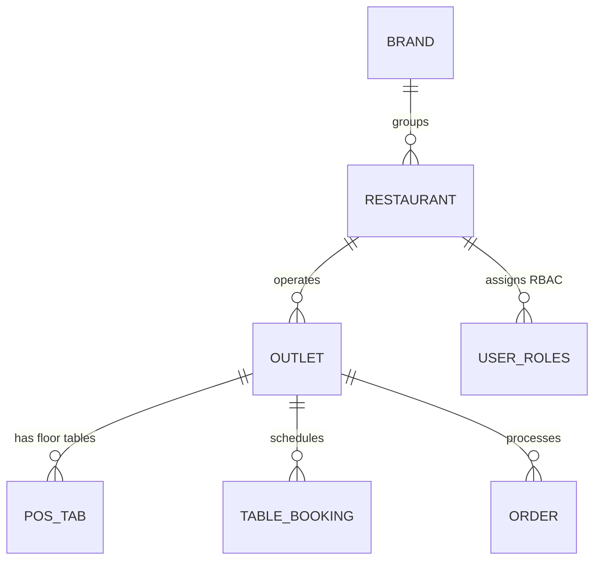

# Workflows Documentation

End-to-end data flows across Billjot's major subsystems.

---

## 1. Multi-Tenant Architecture & Auth Routing (`proxy.ts`)

1. **Session & RBAC:** `proxy.ts` (Next.js 16 middleware replacement) refreshes Supabase cookies, bypasses PWA static assets (`/sw.js`, `/offline`, icons), and protects admin/POS paths, preserving internal `next` return URLs for signed-out redirects.
2. **Role Landing (`resolveDefaultHome`):** `admin`/`manager` land on `/r/[slug]/admin/orders`; `user` (Cashier) and `captain` land on `/r/[slug]/pos`.
3. **Custom Domains:** Custom hostnames are resolved via `restaurant_slug_for_domain(host)` and rewritten transparently to `/r/[slug]`.

---

## 2. Running Table KOTs & Captain / Cashier POS Billing

1. **Seat / Open Table:** Cashier or Captain picks a floor table (`pos_tabs`) inside `/r/[slug]/pos`.
2. **Modifiers & Send KOT:** Staff configures items via `ModifierDialog` (`lib/customizations.ts`: single/multi limits, `max_qty`, `variant_prices`, `free_selections`, quick kitchen prep notes) and clicks **Send KOT**.
   - First KOT creates one open running order linked at `pos_tabs.order_id` (`customer_email = 'pos+open@billjot.local'`).
   - Subsequent KOTs append new `order_items` to that same order; KDS highlights late additions using `order_items.created_at`.
3. **Audit & Table Moves:** Managers can void already-sent items with a mandatory reason (`voidSentItemAction`), or move active tabs between floor tables (`moveTabAction`).
4. **Settlement & Z-Register:** Cashiers (refused for Captains) apply coupons or flat discounts (including booking deposit credits), choose a tender (Cash, UPI, Card, Online link, or Customer Khata), settle the single running order, and reconcile daily totals + cash vouchers in `/r/[slug]/admin/register`.

---

## 3. Table Bookings, Waitlist & Cover Deposit Flow

1. **Availability Calculation (`lib/bookings.ts`):** Slots are generated within outlet `opening_hours` in the outlet's timezone; capacity matches tightest-fitting free tables (`pos_tabs`) while reserving slots for unassigned bookings.
2. **Scheduled Booking / Cover Deposit:**
   - Guests book on `/r/[slug]/book` (or staff create bookings via `/r/[slug]/admin/bookings` or POS `PosHostDeskDialog`).
   - If an outlet deposit rule applies (`party_size >= booking_deposit_min_party` and `booking_deposit_per_guest > 0`), bookings enter `pending_payment` (`20`-minute temporary capacity hold) until Razorpay/Stripe verification or gateway webhook confirms them to `confirmed` / `deposit_status: "paid"`.
3. **Walk-in Waitlist:** Host or public guest joins the live queue (`WL-XXXXXX`), receives a daily sequential token (`#1, #2, …`) and real-time wait ETA, and receives a 1-tap WhatsApp "table ready" alert when notified.
4. **1-Tap POS Seating:** Clicking **Seat & Open Table** in POS Host Desk or Admin marks the booking `seated`, opens the assigned floor table, and carries over any paid cover deposit as a flat bill credit (`discountFlat`).

---

## 4. Back-Office Operations (HR, Vendors, Khata & Corporate GST)

1. **Staff HR Payroll:** Record daily/bulk attendance & overtime (`hr_attendance`) + mid-month cash/UPI advances (`hr_advances`), then auto-compute monthly salaries (`hr_payroll_entries`), adjust bonuses/deductions, settle payouts, and export payroll CSVs.
2. **Procurement:** Create GST Purchase Orders (`vendor_purchase_orders`) against suppliers (`vendors`), mark Goods Received (`GRN` with supplier invoice details), and log vendor payments (`vendor_payments`) to track payable balances.
3. **Credit Tabs & B2B Tax Invoices:** Track regular customer credit limits & settlements (`customer_tabs`) alongside corporate B2B clients (`corporate_clients`), generating CGST+SGST (intra-state) or IGST (inter-state) A4 Tax Invoices (`corporate_invoices`, SAC `996331`) from settled orders.
